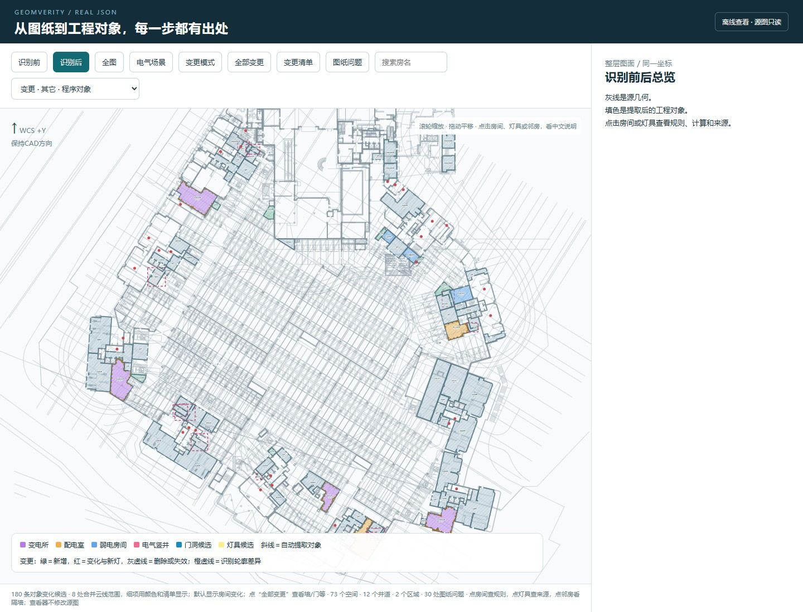
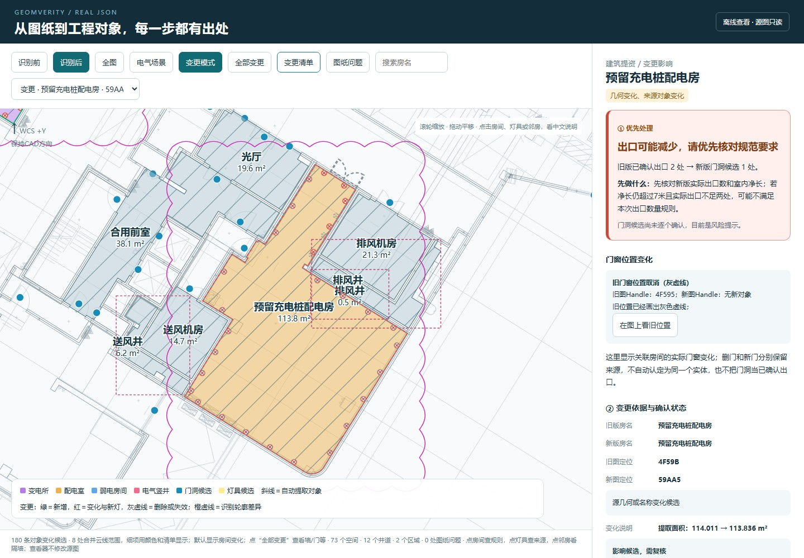
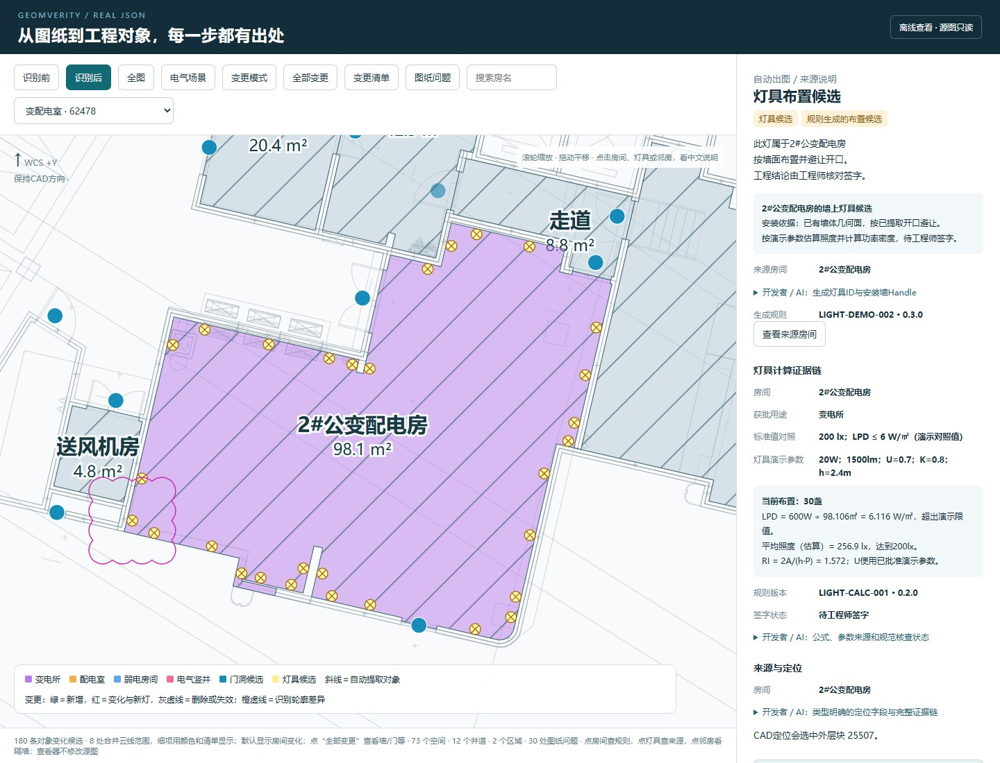
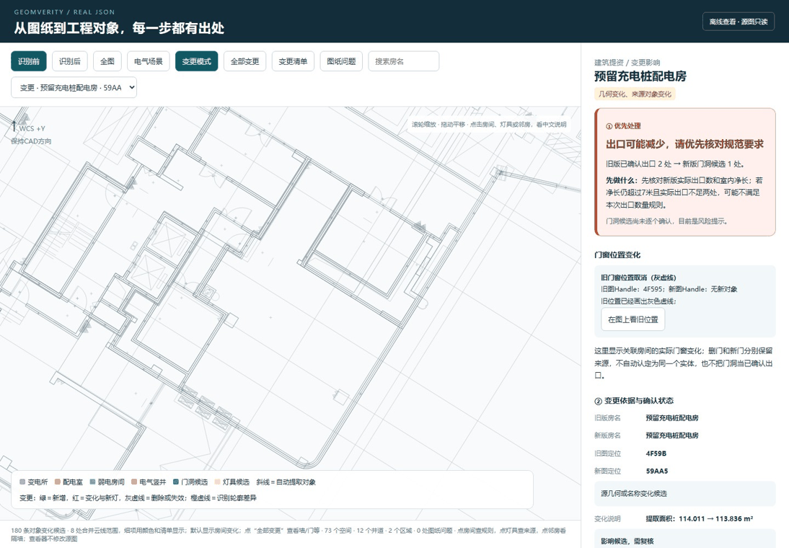
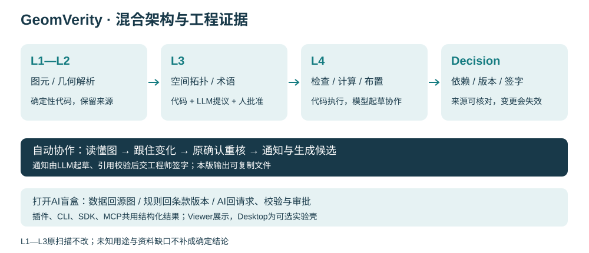

# 《面向建筑机电设计的CAD语义解析与可追溯自动化框架》

项目代号：GeomVerity · 几何求真

[](https://github.com/paigu3571/GeomVerity/actions/workflows/python.yml)

**开源工程语义与可信AI框架**  
从几何数据，到可信工程决策。  
*Open-Source Engineering Semantics & Trustworthy AI Framework*

GeomVerity将CAD图元转为带来源引用的工程对象。确定性几何算法、受约束的模型提议与专业规则共享对象和证据；图纸换版时，分析变化、核对旧确认是否仍有效，并生成可追溯的设计辅助结果。

[GitHub](https://github.com/paigu3571/GeomVerity) · [Gitee](https://gitee.com/xiangle7/geom-verity) · [在线演示](https://paigu3571.github.io/GeomVerity/) · [文档导航](docs/README.md)

## 演示画面

|工程对象|删门风险|灯具证据|
|---|---|---|
|[](docs/images/recognition.jpg)|[](docs/images/door-risk.jpg)|[](docs/images/lamp-evidence.jpg)|



## 快速开始

Python 3.11+。在仓库根目录运行：

```powershell
python -m pip install -e ".[dxf]"
python -m cst.demo
```

首次安装需要网络；演示阶段不需要AutoCAD或API key。也可运行`powershell -ExecutionPolicy Bypass -File scripts/run_demo.ps1`；Linux/macOS使用`sh scripts/run_demo.sh`。

打开`dist/demo/changes/semantic_view.html`查看两版变化；`dist/demo/notifications/notice.md`保存协作通知，`dist/demo/bundle`保存决策与校验清单。[预期结果与排错](docs/acceptance/demo.md)。

## 架构



- **CAD宿主适配：** C#读取天正原生对象，导出L1/L2/L3 JSON。
- **确定性引擎：** 几何、匹配、规则和布置由程序执行；Python核心可脱离Viewer与Desktop运行。
- **受约束AI：** 模型提出用途、规则草案和通知；程序检查引用，工程师批准专业判断。
- **Trace：** 决策记录输入指纹、规则来源、模型缓存和人工确认范围；Viewer、SDK与MCP读取同一结果。

[分层与证据边界](docs/architecture/engine.md) · [换版匹配](docs/architecture/change-analysis.md)

## 功能与实测

| 功能 | 当前范围 | 验证资料 |
|---|---|---|
| CAD语义 | AutoCAD 2016/T20 V8宿主扫描；公开A/B分别73/48个空间 | [宿主记录](docs/acceptance/cad-host-validation.md) |
| 规则检查 | 四条机房条件规则及共井草案示例；A/B中R1分别2/1项满足已核对条件 | [规则验收](docs/acceptance/rules.md) |
| 提资变更 | 对象变化、隔墙关系、影响候选、旧确认及灯组失效 | [8项人工对照](eval/change_test.md) |
| 工程AI | 问答、术语提议、规则起草和协作通知；支持缓存重放 | [AI验收](docs/acceptance/ai.md) |
| 自动出图 | 沿墙避门灯具候选和独立DXF；矩形照度公式演示 | [结果验收](docs/acceptance/changes.md) |
| 可追溯决策 | 输入、规则、模型与人工确认记录；证据包哈希核验 | [证据包验收](docs/acceptance/evidence.md) |
| SDK/MCP | SDK核心调用与七个只读MCP工具 | [接口验收](docs/acceptance/interfaces.md) |

两名工程师单次对照：传统人工组40分钟发现5/8；工具组含约5分钟扫描，总计约10分钟发现8/8。[人工与工具计时](eval/human_vs_tool.md)。

实际模型返回112个去重房名。原关键词未覆盖的46种名称中，模型为42种提出可审核类别，4种保留UNKNOWN；原关键词未覆盖的46种中，工程师审核后启用45种（包含人工修正）。工程师已审核63项：43项采纳、20项修改；56项启用，采光天井及6项上空名称暂缓启用。修改后的类别不算模型直接判断正确。49种人工名称的35/49一致对照保留在详细评测中。[样本与不一致明细](eval/llm_naming.md)。

首次冻结的8项改图对照为6项对应、1项部分、1项不一致；人工记录房名笔误更正后为7项对应、1项部分。

## 运行要求

Python 3.11+、64位系统。完整演示建议至少8GB整机内存、运行前可用内存至少5GB；CAD和浏览器并行建议16GB。Windows完整演示本次340.359秒、峰值3873.98MiB；Ubuntu本次384.27秒、峰值4102.84MiB。512MB沙盒中的完整demo、check和全量测试曾因内存不足中断，不支持以512MB作为完整演示配置。实测峰值、耗时和建议内存见[运行测量](eval/runtime.md)。已生成的离线HTML可直接用浏览器打开，无需在本机重算。

缩减运行范围可用 `python -m cst.demo --changes-only`，只执行A→A-change链路，跳过A/B独立报告及问答/草案全组重放；实测峰值仍接近4GB，不适合512MB环境。

## 使用接口

```powershell
python -m cst summary samples/A
python -m cst verify samples/A
python -m cst check samples/A
python -m cst diff samples/A samples/A-change --output dist/changes/example
python -m cst bundle samples/A-change --changes dist/changes/example/diff.json --output dist/bundle/example
python -m cst verify dist/bundle/example
```

输入为配套JSON快照。DWG扫描使用CAD插件。[CAD构建与加载](docs/guides/cad-build.md) · [CLI](docs/api/cli.md) · [SDK](docs/api/sdk.md) · [MCP](docs/api/mcp.md) · [数据契约](docs/api/schema.md)。

## 测试与贡献

```powershell
python -m unittest discover -s python/tests -v
```

[代码贡献](CONTRIBUTING.md) · [规则贡献](docs/guides/rule-contribution.md) · [构建与测试](docs/guides/development.md)。规则贡献者可直接提交条款、适用条件和三类案例，由维护者协助整理YAML。

## 已知局限

跨楼层、房名错位、出口资格和专业措施资料可能缺失。曲线采样的IsExact标记需进一步修正。灯具为布置候选；真实异形机房不做矩形照度回算。模型引用校验有明确覆盖范围，专业结论需要相应资料与工程师确认。[完整边界](docs/guides/limitations.md)。

## 维护与许可

著作权人、原作者及维护者：张田。其他贡献者和第三方保留各自权利。自有代码使用[MPL-2.0](LICENSE)，依赖见[NOTICE](NOTICE)。[维护](docs/guides/maintenance.md) · [路线图](docs/architecture/roadmap.md) · [安全报告](SECURITY.md) · [治理角色](GOVERNANCE.md)。

GeomVerity combines deterministic geometry processing, constrained LLM proposals, engineering rules and traceable decision records. It supports CAD snapshot analysis, version comparison and auditable engineering assistance.

当前交付为[v0.3.1](https://github.com/paigu3571/GeomVerity/releases/tag/v0.3.1)。[正式协作通知](https://paigu3571.github.io/GeomVerity/notice.html)提供风险分组、版本时间与每句来源。
