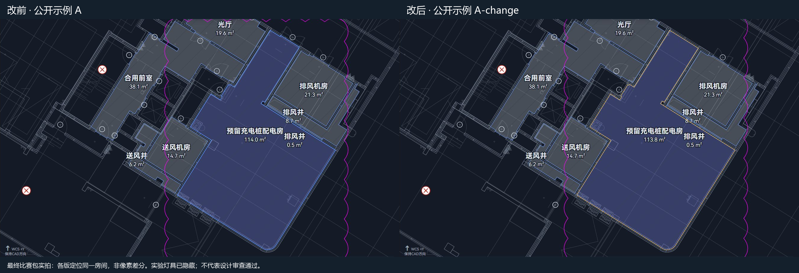
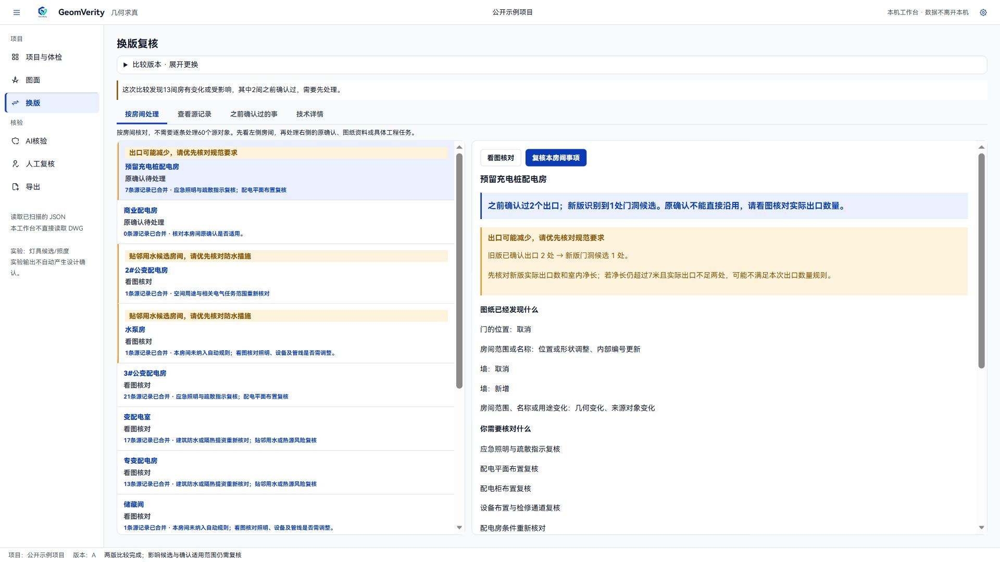
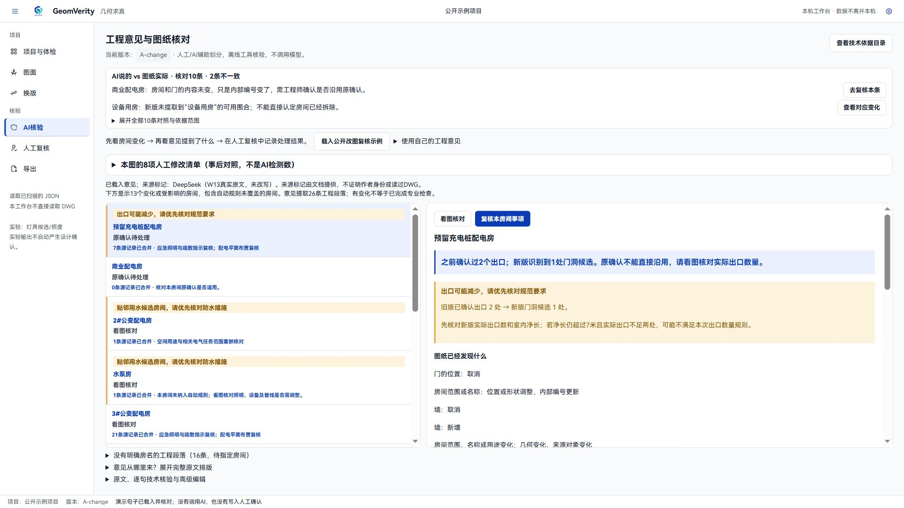
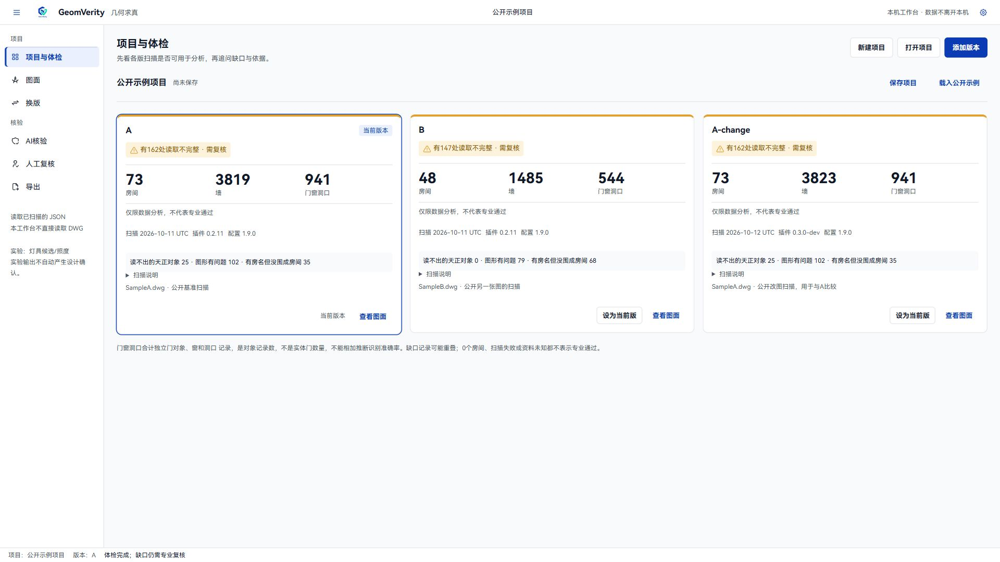

# GeomVerity · 几何求真

## 让工程判断，跟得上图纸变化

**工程 AI 成果可追溯与多层核验的开源框架及工作台。** 图纸改版后，找出哪些旧确认依赖了被改动的门、墙、房间，提醒工程师复核；AI 写的工程意见，拿回当前图纸数据核对。CAD 换版复核是当前验证场景，最终专业判断由工程师负责。

[下载 Windows 程序 · GitHub](https://github.com/paigu3571/GeomVerity/releases/tag/v0.4.0-beta.1) ｜ [国内下载 · Gitee](https://gitee.com/xiangle7/geom-verity/releases) ｜ [上手指南](docs/guides/workbench.md) ｜ [开发与接口文档](docs/README.md)

**北京赛比赛版本：v0.4.0-beta.1，已于 2026-10-28 公开发布。** 两端均可下载；“预览版 / Pre-release”表示软件成熟度，并非尚未公开。当前保留此版本参赛，不把发布等同于完成通用性或专业验收。

> 打开公开示例 → 按房间看改动 → 对照 AI 意见与图纸 → 记录人工复核 → 导出证据包。

## 为什么做这件事

建筑删掉一扇门，电气工程师以前确认的“这间配电房有两个出口”还能不能沿用？AI 写来一份复核意见，说的是哪一版图、哪一个房间，依据又在哪里？

- **改图信息难以传到位。** 下游需要知道改了什么，还要知道牵连了哪些已经确认的结论。
- **以前的确认可能过期。** 对象、输入条件或规则变了，不能只凭记忆沿用旧判断。
- **AI 意见需要核对。** 文字说得通，不代表引用、面积或“已确认”的状态与当前资料一致。

读图、比图之外，GeomVerity继续追问：**这次改动影响了哪条旧判断？依据是什么？接下来需要人核对什么？**

## 一扇门，走通一次复核

公开示例使用同一图纸的 **A → A-change**。先按房间收拢变化，再处理原来的确认：本例显示 **13 间变化或受影响房间，其中 2 间有原确认，需要优先处理**。这不是说只检查这两间，完整变化仍然保留。

### 门变了，原确认不能直接沿用

**预留充电桩配电房：** 旧记录确认过两个出口，新版门洞候选减少。工作台提示原确认失效，并能返回图面查看旧门位置，帮助工程师重新核对实际出口。



*同一房间在两版中分别定位后并列，非像素差分；实验灯具已隐藏。门洞候选不等于合格出口，原确认失效也不等于程序已判定设计不合格。图片来源见[实拍清单](docs/images/v0.4/provenance.json)。*

### 只是编号变了，请工程师确认对应关系

**商业配电房：** 房间和门的内容未变，但 CAD 内部来源编号变化。软件将其列为来源待对应，不自动沿用旧确认。工程师看图确认是同一房间后，才能在原事项、原范围内沿用；这不是整间房或整张图的批准。



## AI 说的，和图纸实际对得上吗

工作台保留工程意见原文，把其中可核对的说法与当前图纸记录、变化和旧确认状态对照。**不一致项可跳转到对应人工复核；没有自动复核项的，先查看对应图纸变化。**

| AI 意见中的说法 | 当前依据与需要做的事 |
|---|---|
| 预留充电桩配电房：原确认因变化失效，需复核 | 与当前记录一致；门洞候选减少，实际出口仍须工程师看图核对。 |
| 商业配电房：原确认因变化失效，需复核 | 与当前策略不一致；内容未变、来源编号变化，需要确认对应关系后决定能否沿用。 |

公开示例从原文中摘出 **10 条**可对照说法，显示 **2 条不一致**。这是本样例、当前规则下的文字对照计数，不是图纸改动数，也不代表全文或设计已检查通过。摘要最多列出 10 条；更细的逐条核验针对显式划出的对象引用、面积和有限确认状态，未覆盖或无法核对的内容如实保留。



外部 AI 的意见可预先生成，再导入本机核对；**本机核验流程不需要调用大模型**。使用自己的文字时，需要人工或 AI 辅助划出明确主张，不能把整篇自然语言都当作已自动理解。具体范围见[主张核验说明](docs/api/claims-check.md)。

## 工程师如何把事情处理完

| 步骤 | 在工作台做什么 | 留下什么 |
|---|---|---|
| 读图与体检 | 导入 CAD 采集的 JSON，查看房间、墙、门和资料缺口 | 源对象、版本与诊断提示 |
| 比较两版 | 选同一图纸的旧版与新版，按房间查看变化和旧确认 | 变化、依赖及确认适用性 |
| 核对意见 | 对照 AI 原句与当前依据，查看不一致项 | 原文、主张与核验结果 |
| 人工复核 | 看图后写清当前事项的意见、范围和待办 | 已记录、待补资料或驳回履历 |
| 归档交接 | 导出证据包，重新打开并核对文件摘要 | 当时的扫描、原文、依据及人工记录 |

**待处理**是尚未完成记录的事项；明确登记缺资料后进入**待补资料**；复核意见可在**已记录**中找回。驳回后回到待处理，历史保留。人的意见与工具结论分别保存：记录“已看过”不会把“无法判定”自动改成“通过”。

证据包帮助下一位工程师看清“当时依据什么、记录了什么、还缺什么”。文件摘要检查包内一致性，**不等于身份认证、数字签章或工程结论正确**。详见[确认继承机制](docs/mechanisms/confirmation-inheritance.md)、[证据包机制](docs/mechanisms/evidence-bundle.md)。

## 已经验证了什么

| 证据 | 当前结果与范围 |
|---|---|
| 本地自动测试 | 本版 206 项通过，完整离线演示通过；测试不等于专业准确率。 |
| 远端自动验收 | [Python 离线验收](https://github.com/paigu3571/GeomVerity/actions/runs/40621412551)与[发布验收和运行测量](https://github.com/paigu3571/GeomVerity/actions/runs/40621412496)均通过。 |
| 发布包 | GitHub、Gitee 的同一 ZIP 回下载摘要一致；分别解压至空目录，浏览器启动探针通过。 |
| 早期人工对照 | 两位工程师各一次：人工 40 分钟找到 5/8；工具辅助含扫描约 10 分钟报告 8/8。程序冻结输出另记 7 项对应、1 项部分对应。仅一次观察，不作自动 100% 或普遍提效承诺。 |
| 尚需补充 | 读图与专业核对准确率的系统评测、独立工程师盲标、多人多图和异机完整试用。 |

公开示例中的 **180 条源变化记录、13 间变化或受影响房间、10 条文字对照、2 条文字不一致**属于不同计数口径，不能相互替代。8 项人工改图清单是事后对照，不能当作 AI 检出数。

验证细节与未完成项：[本版发布检查](docs/acceptance/release-0.4.md) · [能力状态表](docs/status.md) · [早期人工对照](eval/human_vs_tool.md)。

## 下载与体验（Windows）

1. 从 [GitHub 本版发行页](https://github.com/paigu3571/GeomVerity/releases/tag/v0.4.0-beta.1)或 [Gitee 发行页](https://gitee.com/xiangle7/geom-verity/releases)下载程序 ZIP 与 `SHA256SUMS.txt`。
2. 解压**整个**文件夹，双击 `GeomVerity/GeomVerity.exe`；保留 EXE 与 `_internal` 等配套文件，不能单独复制 EXE。
3. 需要系统已安装 **Microsoft Edge WebView2 Runtime**；也可运行 `GeomVerity.exe --browser` 使用本机浏览器工作台。
4. 在“项目与体检”载入公开示例，从 **A → A-change** 开始。**B 是另一张图，不是 A 的新版。**
5. 依次体验“换版 → 图面 → AI 核验 → 人工复核 → 导出”。首次生成和比较需要等待，缺资料或“无法判定”不能当作通过。



查看已采集的公开示例不需要 CAD；**采集自己的图纸仍需合法 CAD 宿主与适配采集器**，工作台不会直接读取 DWG。本机分析不上传图纸；自行使用外部模型时，应另行管理资料授权与传输范围。详见[工作台上手](docs/guides/workbench.md)、[CAD 构建](docs/guides/cad-build.md)和[图纸适配](docs/guides/drawing-adaptation.md)。

**演示视频：本版成片链接待补。** 当前四张图片来自最终发布包的公开示例实拍，不用旧工作台视频冒充本版操作。[图片来源与摘要](docs/images/v0.4/provenance.json)。

## 如何接入、扩展与贡献

代码、JSON 数据格式和规则格式开放，提供 **CLI、Python SDK 和 9 个只读 MCP 工具**，供其他软件与 AI 查询对象、变化、影响和核验依据。采集器提供可追溯输入，确定性代码计算几何、比较依赖并执行有限规则，模型可提出术语或意见，工程师作专业判断。

- **工程师贡献规则：** 提供合法条文出处、版本、适用条件，以及通过、不满足、缺资料三类例子，专业核对后执行。
- **适配不同图纸：** 提供图层／块名对照、宿主版本与脱敏诊断，按样例分别验收；公开契约不代表已经适配所有采集器。
- **接入已有工具：** 使用 [CLI](docs/api/cli.md)、[SDK](docs/api/sdk.md)或[只读 MCP](docs/api/mcp.md)；当前没有工单自动同步、Agent 写入人工批准或代签功能。

详见[贡献指南](CONTRIBUTING.md)、[规则贡献](docs/guides/rule-contribution.md)、[适配指南](docs/guides/drawing-adaptation.md)和[架构](docs/architecture/engine.md)。不提交原始项目图纸、客户资料、密钥或私人复核记录。

## 当前边界与下一步

- **宿主与专业范围有限：** 现有采集宿主实测为 AutoCAD 2016 + 天正 T20 V8；规则目前覆盖有限机房检查，其他版本、专业与项目须单独适配验证。
- **资料不足保留未知：** 缺室内净长、有效出口、上层资料或隔墙做法时不能直接判断；AI 核验不覆盖全部自然语言语义。
- **灯具仍是实验：** 布置与照度估算为候选研究，不作施工或设计批准依据。
- **人工验收尚未齐全：** 原生退出探针未通过，原生完整操作、异机与完整专业验收待补；浏览器探针通过不替代这些关口。

下一步先做独立盲标和更多工程师试用，再完善补资料重算、可打印提醒单和合作方适配。图纸会审、设计变更、概预算、竣工验收和运维是后续探索方向；**当前实测仍是设计校审场景**。AI 生成 → 核验 → 修改 → 再核验属于规划，尚未形成通用自动生图闭环。完整边界见[已知局限](limitations.md)。

## 从源码运行

需要 Python 3.11 或更高版本。在仓库根目录安装：

```powershell
python -m pip install -e ".[desktop,dxf]"
python -m cst.desktop
```

无桌面壳时加 `--browser`。完整离线演示为 `python -m cst.demo`，快速子集为 `python -m cst.demo --quick`，二者验收范围不同。MCP 可选依赖与配置见[接口文档](docs/api/mcp.md)。项目分发包名保留 `cad-semantic-trace`。

## 作者与许可

作者与维护者：**张田**，建筑电气设计工程师。专业同事参与规则验证与功能测试；个人开源项目与单位业务采用分别认定。源码采用 [MPL-2.0](LICENSE)，第三方组件与来源见 [NOTICE](NOTICE)，请保留原作者与许可证。公开包不分发商业 CAD 组件或原始 DWG。

**AI 可以查，工程师作专业判断。让每一个判断都有出处。**
