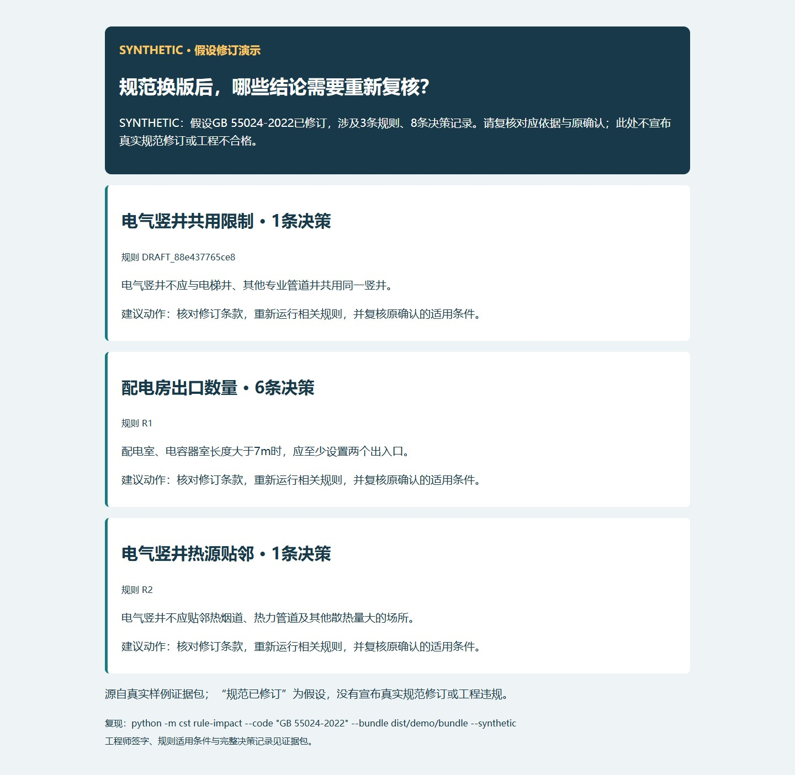

# 规则来源字段验收

2026-10-14；本轮只补来源元数据与显示，不改规则条件或规范数值。规则SHA256按原始YAML字节计算，放在决策与外部清单中，避免文件自引用哈希。

|规则|条款与规范版本|起草来源|批准人|文件SHA256|
|---|---|---|---|---|
|R1|GB 55024-2022 3.2.1第1款（2022）|首次起草者未独立登记|张田|28c96c5cd8034c559b4579f7568eed5bd820f63cd5ee54d7ba9a8af973e6185f|
|R2|GB 55024-2022 6.2.8第2款（2022）|首次起草者未独立登记|张田|43b77056564abda87390755193c3cd6df88163ef8d61b9ff14352d6857e6862c|
|R3|GB 51348-2019 4.2.1第6款（2019）|首次起草者未独立登记|张田|650465fba365882a0068b24214e2d6b3f7bcf80d291d842f4180323c7825bfce|
|R4|GB 51348-2019 4.2.1第6款（2019）|首次起草者未独立登记|张田|99720bd12ab6c26ee76107c733c9afc6d3fe3dda8601f4e834f2263fa6e6f95f|
|DRAFT_88e437765ce8|GB 55024-2022 6.2.8第1款（2022）|DeepSeek|张田|bf09a81c58be33918fa8998f1b8bf6807bb357e7c172fca56f1473980a6ac79f|
|LIGHT-CALC-001|GB/T 50034-2024 表5.5.1（2024）；GB/T 50034-2024 6.3.15、6.3.16（2024）|张田|张田（2026-10-13演示近似授权）|0b33e511b942237e2ffb61e0e1f226c55c7b503e029bd8be2741cf8ef46997fe|

六项规则均有条款、规范版本、批准人和文件摘要。共井规则的真实模型为deepseek-flash，缓存ID为draft_8207071988f47e84b2e38bca，原始提议与后续批准分开保存。照度规则采用张田给定并授权的演示参数，具体规范数值核验边界保留在规则中。

R1～R4的首次起草者没有独立登记，本轮明确标为HISTORICAL_UNRECORDED，不把条件审核追认为初版起草。Viewer规则卡显示条款、规范版本、起草来源、审批人、SHA256；AI来源另显示模型与缓存ID。

机器可读完整核对表：[rule_provenance.json](../../eval/rule_provenance.json)。规则元数据目录：[provenance.yaml](../../rules/provenance.yaml)。

## 假设规范修订的演示

运行 `python -m cst rule-impact --code "GB 55024-2022" --bundle dist/demo/bundle --synthetic`。

当前A-change证据包查询涉及3条规则、8条决策记录。SYNTHETIC只表示“假设该规范已修订”，不宣称真实修订、工程违规或确认已经撤销。

## v0.3.2验证

- 公开源码路径下90项Python测试、69项C#核心测试通过；未重新宣称CAD宿主实扫。
- 194条决策，证据包摘要校验0失败；未附原DWG，源字节核验明确跳过。
- 后台浏览器点击2#公变配电房灯具：用途为配电室，LPD与照度估算可查看；通知保持2项优先、6项复核、3项记录，坐标默认折叠。
- 历史房名实验金标准另行冻结，当前获批分类变化不回写35/49原评测答案；没有重新调提示词或追分。

- 新建隔离虚拟环境完成非editable安装；已安装CLI的summary与verify正常，规则资源含起草来源目录；verify失败0项，未附源字节单列。
